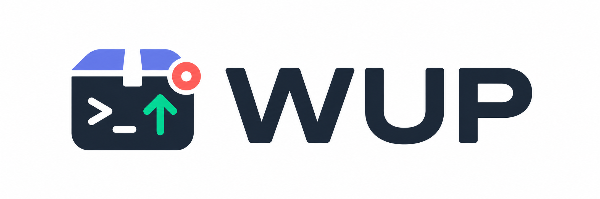
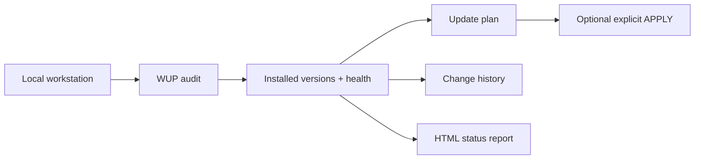

<p align="center">
  
</p>

<h1 align="center">WUP</h1>

<p align="center">
  
  
  
  
</p>

<p align="center"><strong>Know when your developer toolchain needs attention — locally, on demand.</strong></p>

WUP is a small, local-first developer toolchain watcher. You run it when you want an answer. It audits installed tools and runtime health, classifies findings, can record meaningful local changes, and can produce a descriptive update plan or local HTML status report.

WUP is read-only by default: it does not install, upgrade, restart, or reconfigure the software it monitors.

## Why WUP

Developer machines accumulate CLIs, runtimes, package managers and local services that drift at different speeds. WUP keeps the boring part visible without becoming another always-on platform:

- local audit of installed versions and selected health signals;
- deterministic `CURRENT`, `WATCH`, `UPDATE`, `URGENT`, and `UNKNOWN` semantics;
- read-only diagnostics and setup preflight;
- descriptive update plans and an explicit, foreground-only APPLY for supported npm-managed tools;
- local change history and a self-contained HTML status report.

There is no WUP-hosted account system, VPS, daemon, scheduler, database, notification channel, or control plane required.

## What it monitors

The current Windows-first catalog includes probes for tools such as Codex CLI, OpenCodex, Codex Desktop, Node.js/npm, Bun, Python, Git, LM Studio and Wrangler, plus selected local integration/runtime checks. Detection rules and authoritative upstream sources are documented in [`references/managed-tools.md`](references/managed-tools.md).

The catalog is intentionally conservative: if WUP cannot obtain trustworthy evidence, it reports `UNKNOWN` rather than inventing a clean bill of health.

## How it works

All WUP functions run locally and only when you invoke them:



The audit is authoritative for what is installed on this workstation. Public version sources are used only to determine the latest appropriate release. No WUP process runs in the background after a command exits.

## Quick start (Windows)

```powershell
git clone https://github.com/datawarsaw/wup.git
cd wup
Copy-Item wup.example.toml wup.toml
python -m unittest discover -s tests -p 'test_*.py'
python scripts/check_toolchain.py --offline
python scripts/check_toolchain.py --json
```

Python 3.10+ is required. Node.js is needed only for Node-based checks.

Use `--offline` when you want local probes only. A normal run also queries the documented public release sources.

## Compatibility changes

WUP no longer contains notification, scheduler, remote-sentinel, or workstation-snapshot paths. This is a deliberate compatibility break:

- `doctor.py` and `preflight.py` no longer accept `--state-path` or `--skip-scheduler`.
- Doctor diagnostics now cover repository integrity, configuration validity, and runtime prerequisites only.
- Configuration is limited to `[tools]` and `[local]`. Legacy `[notifications]` and `[remote]` sections are ignored and should be removed.
- The notifier, Telegram/email adapters, Windows Task Scheduler manager, and GitHub Actions sentinel are removed; WUP no longer maintains remote state. Existing tasks, secrets, and remote branches are not removed by this code change.
- Former alert-deduplication state is not used; local change history remains available through `change_history.py`.

## Diagnostics (Doctor)

Run the strictly read-only diagnostics to verify repository integrity, configuration validity, and runtime prerequisites without making any changes:

```powershell
python scripts/doctor.py
python scripts/doctor.py --json
```

`doctor.py` is strictly non-mutating: it never creates, edits, or deletes configuration, state files, or scheduled tasks.
Its default output is human-readable; use `--json` for deterministic local automation output. Exit code `0` means healthy or optional-only degradation, `1` means an unhealthy required check, and `2` means no report could be produced. Configuration values are never printed.

## Setup preflight

Check whether this machine is ready to activate WUP without installing, repairing, configuring, or activating anything:

```powershell
python scripts/preflight.py
python scripts/preflight.py --json
```

The preflight is a read-only projection of the existing doctor checks: required unhealthy checks are blockers, while optional degraded checks remain warnings. Exit code `0` means `READY`, `1` means `NOT_READY`, and `2` means a report could not be produced. JSON output includes only check names and safe messages; it never prints credentials, configuration values, or diagnostic details.

## Update Plan

Generate a deterministic, descriptive update plan from audit results without executing any updates:

```powershell
python scripts/check_toolchain.py --json | python scripts/update_plan.py
python scripts/update_plan.py --input-report <path-to-report.json> --json
```

`update_plan.py` is strictly descriptive and read-only: it describes known update state using existing WUP findings, performs no installation or mutation, and never executes planned commands.

The PLAN also records a declarative update mechanism, automation mode, inert planned instruction, and post-update verification guidance where the repository has an unambiguous mechanism. `AUTOMATABLE` is limited to supported npm-managed tools; Codex CLI falls back to `MANUAL` or `UNKNOWN` for Windows App/MSIX, binary, metadata-only, or otherwise ambiguous installations. Unsupported tools remain `UNKNOWN` without guessed commands. These fields are data only; PLAN never executes them and provides no APPLY operation.

## Update Apply (Stage B)

Explicitly apply an available update for supported npm-managed CLI tools:

```powershell
python scripts/update_apply.py --tool OpenCodex
python scripts/update_apply.py --tool Wrangler
python scripts/update_apply.py --tool "Codex CLI"
```

`update_apply.py` is an optional, foreground-only execution tool. It operates under strict safety constraints:
- **Allowlisted tools only**: OpenCodex (`@bitkyc08/opencodex`), Wrangler (`wrangler`), and Codex CLI (`@openai/codex`). Codex CLI is supported only when installed via npm; Windows App/MSIX or binary installs are rejected. Unsupported tools remain PLAN/manual only.
- **One tool at a time**: Batch updates and `--all` are not supported.
- **Interactive confirmation**: Prompts for confirmation by default before any mutation; pass `--yes` to proceed non-interactively in foreground scripts.
- **No privilege escalation**: Runs within the user's existing privileges; if npm requires administrative elevation, the update halts immediately with manual instructions.
- **Pre-execution freshness checks**: Freshly re-verifies installed and target versions immediately before execution to prevent race conditions (TOCTOU).
- **Structured execution**: Invokes npm directly using structured argument vectors (`shell=False`) with bounded timeouts and exact version pinning.
- **Post-update verification**: Re-probes the tool locally after npm completes and confirms the new version and health status before reporting success.
- **No automated rollback**: If an update or verification fails, WUP halts cleanly and outputs deterministic manual recovery guidance referencing the exact previous version.
- **No background automation**: WUP never invokes APPLY automatically.

## Status snapshot

`status_snapshot.py` is a pure projection used by the local HTML status report. It consumes an already-produced audit report and exposes only a tool's name, installed/latest versions, status, health, existing release/docs URL, and fixed provenance (`LOCAL` for installed version, `REMOTE` for latest version). It does not run probes, use the network, read or write state, or retain diagnostics, environment data, credentials, or raw provider payloads. WUP currently has only an audit-report timestamp; the snapshot preserves that explicitly as `audit_report_timestamp` and reports independent per-tool local and remote observation timestamps as JSON `null` / text `unknown` rather than fabricating freshness.

## Local HTML status report

Generate a self-contained local HTML status report from an existing JSON audit report:

```powershell
python scripts/check_toolchain.py --json | python scripts/status_report.py --output wup-status.html
python scripts/status_report.py --input-report <path-to-report.json> --output wup-status.html
```

`status_report.py` is strictly read-only with respect to audits: it never executes probes, calls the network, or starts a local server. It renders an HTML document only to the explicitly specified `--output` destination. The core `render_status_html(snapshot)` function remains pure and performs no filesystem writes. Recent change detail remains available through the existing `change_history.py --view` commands.

## Local change history

Record an existing JSON audit report in a local, append-only JSONL history:

```powershell
python scripts/check_toolchain.py --json | python scripts/change_history.py
python scripts/change_history.py --input-report <path-to-report.json>
```

By default the file is `%LOCALAPPDATA%\WUP\change-history.jsonl` (or under the configured `local.state_dir`). The first observation is an explicit `baseline` record, not a change from nothing. Later runs append a `change` record only when a tool's installed version, latest version, status, or health changes; identical observations add no lines. Records contain only those fields, the tool name, changed field names, and an ISO-8601 UTC timestamp. This history is local only: WUP sends it nowhere.

View recent local history without reading raw JSONL or changing it:

```powershell
python scripts/change_history.py --view
python scripts/change_history.py --view --limit 10
python scripts/change_history.py --view --json
```

The viewer uses the same default path and never creates, repairs, rewrites, or appends history. Baseline output displays the persisted whitelisted tool snapshot; change output displays stored before/after values for changed fields. A missing or empty file reports no history and exits `0`; malformed history fails closed with exit `1` and remains unchanged. `--limit N` selects the most recent N records but displays them in chronological order. Invalid CLI usage exits `2`.

## Configuration

Copy [`wup.example.toml`](wup.example.toml) to `wup.toml` only when you need to change a default. Configuration covers:

- monitored tool selection;
- local state-directory override;
- optional local Workstation Ops/MCP repository path for its audit check;

The TOML file is non-secret. Do not put tokens or credentials in it.

The audit uses `wup.toml` in the current directory by default, or `--config` / `WUP_CONFIG` to select another file. When a config file is present, its tool selection and Workstation Ops path are applied to the audit. Legacy `[notifications]` and `[remote]` sections have no effect.

## Finding semantics

| Status | Meaning |
| --- | --- |
| `CURRENT` | Installed version matches the verified target and relevant checks pass. |
| `WATCH` | Worth attention, but WUP deliberately stops short of recommending an update. |
| `UPDATE` | A newer stable release is verified and a manual update is recommended. |
| `URGENT` | A critical update or broken monitored component needs prompt attention. |
| `UNKNOWN` | WUP could not obtain trustworthy evidence. Never treated as `CURRENT`. |

Health is tracked separately from version status so a current version can still surface a runtime problem.

## Privacy and security

WUP stores local change history outside Git (by default under `%LOCALAPPDATA%\WUP`). Configuration examples contain no secrets.

External network access is limited to the documented public release/version sources. WUP does not require a hosted WUP service.

See [`SECURITY.md`](SECURITY.md) for vulnerability reporting guidance.

## Project status

WUP is an early public project extracted from a tool that already runs in production for its original author. The standalone repository is intentionally conservative: Windows first, read-only by default, and focused on making the existing behavior portable before adding larger features.

Planned ideas include easier installation/diagnostics and refinements to the local status/history view. These are roadmap ideas, not promises or hidden runtime behavior.

## Contributing

Small, focused contributions are welcome. Please read [`CONTRIBUTING.md`](CONTRIBUTING.md) before opening a pull request.

## License

WUP is available under the [MIT License](LICENSE).
